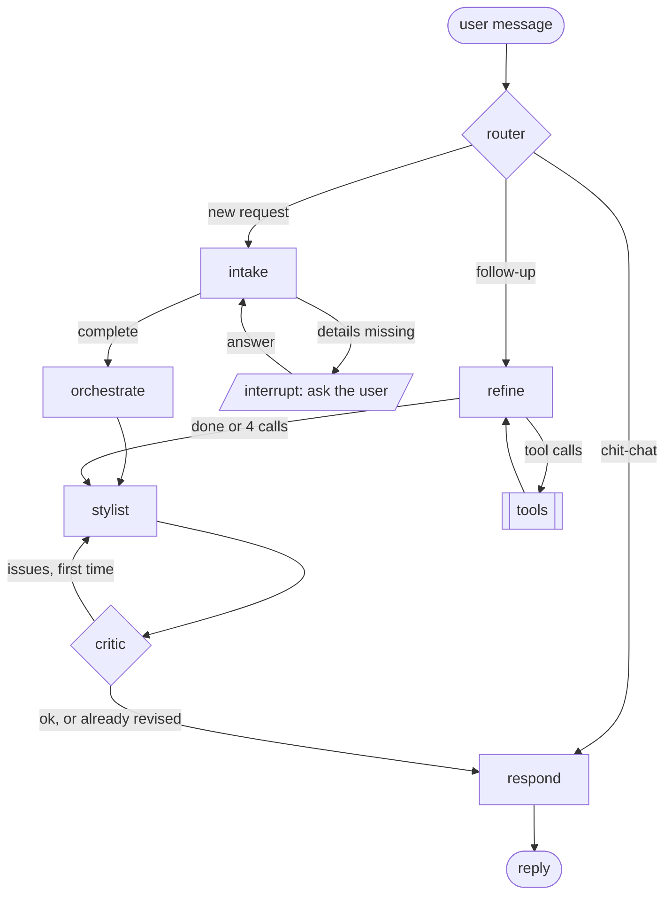

# Outfit recommender

> Built with [Claude Code](https://claude.com/claude-code), Anthropic's coding agent.
> See [how](#built-with-claude-code).

A chatbot that picks outfits from **your own wardrobe**. Photograph your clothes once;
the system cuts each garment out, tags it, measures its color and indexes it. Then
ask *"what should I wear to a party in Pune tonight?"* and a multi-agent system
checks the weather for your outing, applies color theory and dress-code rules, and
explains its pick, asking for anything it needs to know first.

A profile (home city, saved places like "Office" with their dress code and usual
trip, colors and fits you like) makes the chat ask less and rank outfits your way. A
shopping assistant answers **"what should I buy?"** (what your wardrobe is missing
for the occasions you pick, and the pieces that would help most) and **"should I buy
this?"** for a shop photo (buy / maybe / skip, with the outfits it adds). Belts,
ties, bags, sunglasses and other accessories you own finish each outfit, by plain
rules (a belt only with trousers and matching the shoes, sunglasses only in strong
sun). For a trip, the **packing list** first has you confirm the place (name, state,
country), the dates and each day's weather, then packs the fewest pieces that cover
every day and event within your re-wear limits, without the same top and bottom on two
days. **I wore this** logs a rating (and
optionally a photo of you wearing it, matched to your wardrobe locally by CLIP): loved
pairings rise, "not again" ones sink, and "too cold" reports dress you warmer. An
opt-in DeepSeek look check scores the outfit as worn, never the person.

Built as a portfolio project for **agentic AI**: a LangGraph multi-agent workflow
with human-in-the-loop, a bounded ReAct loop and a reflection (critic) step, on top
of local vector search and local CPU inference, measured by a scenario eval against
the real model.

```
you > party in Pune tonight at 7, about 4 hours, half an hour outside, going by cab
bot > For your party in Pune at 7, go with your black button-up shirt, lavender skirt
      and champagne slingback heel pumps. The black keeps things neutral so the
      lavender stands out. It's clear and warm (27-30°C), so light pieces are right.
      If you'd prefer a dress, your blush pink floral midi dress with the same heels
      works well.

you > something with my blue jeans instead
bot > Go with your black button-up shirt, medium blue jeans and champagne slingback
      heel pumps: the dark shirt and heels dress the jeans up nicely. One heads-up:
      the jeans are a bit casual and warm for a party, so keep the rest light.

you > what about office tomorrow at 9
bot > Got it. Which city will you be in? About how many hours will you be out? ...
```

(Real replies from a run on my wardrobe, lightly shortened.)

## Quick start

```bash
git clone <this repository's URL> && cd <its folder>
pip install -e ".[api,ui,dev]"     # PyTorch must already be installed (CPU build is fine)
cp .env.example .env               # then set DEEPSEEK_API_KEY
python scripts/run_app.py          # starts the API and the web app, opens http://localhost:8501
```

For the exact versions it was tested with, install `requirements.txt` first, then the
project itself: `pip install -r requirements.txt` and `pip install -e . --no-deps`.

Add your clothes on the **Wardrobe** page, then ask for an outfit on the **Chat** page.
Optionally fill in the **Profile** page, use **Shopping** to see what to buy,
**Packing** before a trip, and **I wore this** + **History** to teach it what works.
The [user guide](docs/user-guide.md) covers every page, what costs API calls, and
troubleshooting; [Setup](#setup) and [Usage](#usage) below have the details.

### Running the app, step by step

1. **Open a terminal in the project folder and activate the environment** that has
   PyTorch and the project installed:
   ```powershell
   .\.venv\Scripts\Activate.ps1        # Windows PowerShell (use your venv's path)
   source .venv/bin/activate           # macOS / Linux
   ```
2. **First time only:** install the project (`pip install -e ".[api,ui,dev]"`) and
   create `.env` from the template (`Copy-Item .env.example .env` on Windows,
   `cp .env.example .env` elsewhere), then put your key in it: `DEEPSEEK_API_KEY=...`.
3. **Start everything with one command:**
   ```bash
   python scripts/run_app.py
   ```
   It starts the API on <http://127.0.0.1:8000>, waits until it answers, then starts
   the web app and opens <http://localhost:8501> in your browser. The first start
   takes about a minute (it opens the wardrobe and loads CLIP; the first run also
   downloads the rembg and CLIP weights). The sidebar shows whether the API is up.
4. **Stop it** with **Ctrl+C** in the same terminal: it stops both parts.

Options: `--port 8000` (API), `--ui-port 8501` (web app), `--no-browser` (don't open a
tab), `--record` (save every chat turn as JSON in `data/conversations/`).

| Problem | Fix |
|---|---|
| "Port 8000 is already in use" | The app (or `serve.py` / `streamlit`) is already running: stop it, or use `--port` / `--ui-port` |
| "The API stopped while starting" | Read the messages above it. Usually `DEEPSEEK_API_KEY` is missing from `.env`, or another process (`chat.py`, `review_wardrobe.py`) has `qdrant_data/` open: only one process can use the wardrobe at a time |
| `ModuleNotFoundError` | The environment isn't active, or the project isn't installed in it (step 2) |
| Chat or tagging fails with an API error | Check the key and your DeepSeek balance. Browsing the wardrobe, packing and "What should I buy?" make no API calls, so they still work |

To run the two parts in separate terminals instead, see [Usage](#usage).

---

## How it works

### 1. Ingestion: photo → searchable wardrobe

```
photo ─► rembg (ONNX, CPU) ─► DeepSeek vision tags ─► k-means color (LAB) ─► CLIP embedding (CPU) ─► Qdrant
         garment cutouts       category, fabric,        computed locally,       ViT-B-32, 512-d
         (flat-lay or worn)    formality, warmth...     never trusted from LLM
```

- **Segmentation**: `rembg` with open-source ONNX models on CPU (`birefnet-general`
  for flat-lays, chosen in a bake-off of five models on real photos of clothes on a bed,
  plus a step that trims hanger hooks; `u2net_cloth_seg` for worn clothes, which splits
  upper / lower / full body). One photo can yield several garments.
- **Tagging**: DeepSeek (`deepseek-flash`, image input) in JSON mode, validated by
  Pydantic into a `ClothingItem`. Only the cutout, flattened onto grey, leaves the
  machine, never the original photo.
- **Color**: k-means on the garment's pixels in LAB space; the LLM only names it.
- **Embedding**: OpenCLIP ViT-B-32 on CPU; stored in local Qdrant with payload
  indexes for filtering. Item ids are deterministic, so re-ingesting a photo
  updates its items instead of duplicating them.
- **Review**: a CLI to fix wrong tags with a note ("this is a skirt, not shorts"),
  replace an item from a better photo, or delete it.

### 2. Tools: deterministic, unit-tested Python

The agents decide; the rules live in plain code the agents call:

| Tool | What it does |
|---|---|
| `tools/search.py` | CLIP text or "more like this item" search + hard payload filters |
| `tools/weather.py` | Open-Meteo forecast for the outing window → `advise()`: warmth range, outerwear, rain / wind / UV notes, adjusted for transport (wind chill on a two-wheeler, no flowy pieces when riding) |
| `tools/color_harmony.py` | Pair and outfit harmony on the RYB artist's wheel (complementary, analogous, neutrals, contrast), each score with a reason |
| `tools/outfits.py` | Assembles top + bottom or one-piece, adds shoes / outerwear, applies occasion, formality and weather rules, ranks by harmony + fit, keeps results varied, reports wardrobe gaps |
| `tools/match.py` | Resolves "my lavender skirt" to an item by its tags first, CLIP only for ties or when no tag fits |
| `tools/climate.py` | The home city's last year from the Open-Meteo archive → which of hot / mild / cold / rainy days to plan for |
| `tools/shopping.py` | A garment you might buy, against every situation and weather: new outfits, occasions it unlocks, gaps it fills, near-duplicates → buy / maybe / skip with reasons |
| `tools/staples.py` | What to buy: ~30 common pieces and 3 accessories (`staples.toml`), each in the color that suits your wardrobe, picked greedily so suggestions never overlap |
| `tools/accessories.py` | Finishes a chosen outfit: at most one belt, tie, bag, sunglasses ... each, by kind rules (belt needs trousers, tie needs a shirt, sunglasses need sun), harmony and fit; never changes the outfit's rank ([details](docs/phases/accessories.md)) |
| `tools/packing.py` | Trip → a slot per day and event, each with its weather (one forecast, last year's archive past 16 days) → a greedy cover: the fewest pieces that dress every slot within the re-wear limits, an outfit per slot, no top + bottom on two days unless nothing else fits; packs only after the user confirms the place ([details](docs/phases/packing.md)) |
| `tools/variety.py` | Checks a packing plan for repeated outfits and pieces past their limits (`scripts/check_variety.py`) |
| `tools/feedback.py` | The wear log → liked / disliked pairings, recently worn pieces and a warmth bias, fed into ranking like taste, a reason each ([details](docs/phases/wear-feedback.md)) |
| `tools/worn_match.py` | A worn photo's garments (CLIP) against the same-kind wardrobe pieces and what was logged → yours / which was it? / extra / unknown |

### 3. Agents: a LangGraph workflow



| Node | Kind | Job |
|---|---|---|
| `router` | LLM, JSON | New request, follow-up, or chat? Answers chat itself |
| `intake` + `ask` | LLM, JSON + **human-in-the-loop** | Fill occasion, city, timing, hours outdoors, transport; pause with `interrupt()` to ask for what's missing (max 3 questions, then safe defaults) |
| `orchestrate` | **plain Python** | Resolve "my blue jeans" by its tags (CLIP only for ties) → weather → `suggest_outfits` |
| `refine` + `tools` | LLM, **ReAct** (function calling) | Follow-ups: search, show items, change the request and re-plan; max 4 tool calls |
| `stylist` | LLM, JSON | Write the reply from the plan's facts, and nothing else |
| `critic` | code checks + LLM rubric, **reflection** | Catch invented garments, dropped warnings or weather notes; one revision max |
| `respond` | plain Python | Send the reply, or a template built from the plan if the draft can't be trusted |

### Design choices

- **Agents only where language is needed.** A new request always needs the same
  steps (understand → weather → outfits → explain), so that path is a fixed
  pipeline, not ReAct. Only open-ended follow-ups use a ReAct loop, with a hard cap.
- **Every loop is bounded and visible**: question limit, tool-call limit and one
  critic revision are counters in graph state and conditional edges, not hidden
  framework behavior.
- **The LLM never owns facts.** The stylist sees only the plan (no photos, no
  wardrobe), so it cannot recommend something you don't own; the critic checks that
  in code, and a draft that still invents a garment is replaced by a template reply.
- **Code owns defaults and validation.** The intake LLM returns a patch of what the
  message says; code validates each value, applies the only default (leaving now),
  and records every assumption so the reply can mention it.
- **Resumes never repeat LLM calls**: `interrupt()` lives in its own `ask` node,
  because LangGraph re-runs the interrupted node on resume.
- **No LangChain model wrappers**: every LLM call goes through one DeepSeek client
  (OpenAI-compatible) with JSON mode, Pydantic validation and one retry with the
  error fed back. LangGraph only orchestrates.

### 4. Evaluation: measuring the agents

Scripted conversations (21 at the time of the runs below, 36 now, 5 of them with a
user profile) run against the real model with everything else fixed (a
wardrobe snapshot, weather fixtures, a fixed clock), so only the agents vary. Each
turn is recorded node by node and checked against expectations (intent, request
slots, tools called, outfit contents, words in the reply), then summarized per agent:

| Run (each scenario × 3) | Scenarios | Router | Intake slots | Critic revisions | Template fallbacks |
|---|---|---|---|---|---|
| Baseline prompts | 59/63 | 39/39 | 149/150 | 5/77 | 0/77 |
| Final prompts | **63/63** | 39/39 | 150/150 | **1/78** | 0/78 |

Reading the recorded turns led to seven fixes; only three were prompt wording (the
others were tests, a code gap and the critic's token budget, sized from measured
reasoning-token usage). One run scored 63/63 yet showed the stylist and critic prompts
contradicting each other, visible only in a doubled revision rate and critic
reasoning tokens. Before any agent run, the eval's fixed inputs also exposed that CLIP
alone picked the wrong item for "lavender skirt", which led to tag-first item
matching. Details:
[`docs/phases/phase-5-evaluation.md`](docs/phases/phase-5-evaluation.md).

### 5. API: the wardrobe and the agents over HTTP

A FastAPI server wraps the same tested code for the UI and any other client:

| Endpoint | Does |
|---|---|
| `GET /items`, `GET /items/{id}`, `GET /items/{id}/image` | Browse the wardrobe (filter by category, occasion); get cutouts |
| `POST /items` | Upload a photo (`flat` or `worn`): segment, tag, color, embed, store |
| `PATCH /items/{id}`, `POST /items/{id}/retag`, `DELETE /items/{id}` | Fix tags directly or with a note, remove an item |
| `POST /chat`, `GET /chat/{thread_id}` | Talk to the agents: a reply or a question, with the outfits as items and images |
| `GET/PUT /profile`, `/profile/photo`, `POST /profile/analyse` | The profile; an optional face photo and its colouring analysis (1 DeepSeek call) |
| `POST /shopping/suggest` | What the wardrobe is missing and what to buy (no DeepSeek call) |
| `POST /shopping/check`, `POST /shopping/candidates/{id}/add` | Check a shop photo without storing it; add it once bought, without tagging again |
| `POST /packing/preview`, `POST /packing` | Confirm a trip's place, dates and weather; then pack for it |
| `POST/GET /worn`, `PATCH/DELETE /worn/{id}`, `/worn/{id}/photo`, `POST /worn/{id}/look` | Log what you wore; a photo matched locally; the opt-in look scores (1 DeepSeek call) |

- **One process owns the wardrobe**: local Qdrant allows a single process, so the
  server opens it once and shares it between ingestion and chat.
- **The server keeps the conversation**: whether a message answers the bot's question
  comes from the graph's saved state, and a second message to a busy conversation is
  refused (409).
- **Uploads trust the bytes, not the client**: each photo is fully decoded, size-limited
  and saved under a cleaned name; a failed upload leaves nothing behind.

Details: [`docs/phases/phase-6-api.md`](docs/phases/phase-6-api.md).

### 6. UI: Streamlit on top of the API

| Page | Does |
|---|---|
| **Chat** | Talk to the agents; each recommendation shows its outfits as cards with the cutouts of your own clothes, reasons, warnings, wardrobe gaps and a per-turn trace (agent path, DeepSeek calls, seconds) |
| **Wardrobe** | Browse and filter your garments, add a photo, edit tags, re-tag with a note, delete (with a confirmation) |
| **Shopping** | **What should I buy?** for chosen occasions (missing pieces + suggestions with pictures of what they go with); **Should I buy this?** for a shop photo, then **Add to wardrobe** |
| **Packing** | Trip form and events → **Check trip** (which place, dates, every day's weather) → **Pack for this**: the pieces with their days, and an outfit card per day and event |
| **History** | Outfits logged with **I wore this** (on every chat and packing card): photo, what it shows with one-click fixes, opt-in look scores, delete |
| **Profile** | About you, saved places with dress code and usual trip, optional photo colouring |

- **The UI only talks to the API**: it imports no model, database or agent code (a test
  checks the loaded modules), so it could run on another machine.
- **Conversations survive a reload**: the conversation id is in the URL, and the page
  reads it back from the API, including a question still waiting for an answer.
- **Tested headless**: Streamlit's `AppTest` drives every page against the real FastAPI
  app over the same fakes, so a UI test runs through the client, HTTP and API code.

Details: [`docs/phases/phase-7-ui.md`](docs/phases/phase-7-ui.md); the shopping
assistant in [`docs/phases/shopping-assistant.md`](docs/phases/shopping-assistant.md).

The full design (state, data flow per node, failure handling) is in
[`docs/agentic-architecture.md`](docs/agentic-architecture.md). Each build phase is
explained in [`docs/phases/`](docs/phases/README.md).

---

## Tech stack

Python 3.11+ · LangGraph · DeepSeek API via `openai` SDK · OpenCLIP (ViT-B-32, CPU) ·
rembg / ONNX Runtime (CPU) · Qdrant (local mode) · scikit-learn / scikit-image ·
Pydantic v2 · FastAPI / uvicorn · Streamlit · Open-Meteo · pytest · ruff

All local inference runs on **CPU**; no GPU needed.

---

## Setup

1. **Python 3.11+ with PyTorch already installed.** `open_clip_torch` needs torch,
   but it is deliberately not a declared dependency, so installing this project
   never replaces an existing torch build. Install one first if needed (the CPU
   build is enough).
2. Install the package (`api` adds FastAPI and uvicorn for the server, `ui` Streamlit):
   ```bash
   pip install -e ".[api,ui,dev]"
   ```
3. Add your DeepSeek key:
   ```bash
   cp .env.example .env    # then set DEEPSEEK_API_KEY
   ```
   Other settings (models, paths) can be overridden with `OUTFIT_<FIELD>` variables;
   see `src/outfit/config.py`.

The first run downloads the rembg and CLIP weights.

## Usage

```bash
# 1. Add your clothes (photos in data/wardrobe_raw/)
python scripts/ingest_folder.py data/wardrobe_raw --mode flat   # garment alone
python scripts/ingest_folder.py data/wardrobe_raw --mode worn   # worn by a person

# 2. Check and fix the tags
python scripts/review_wardrobe.py [--match skirt]

# 3. Chat
python scripts/chat.py [--verbose]     # --verbose logs what each agent does
python scripts/chat.py --record        # also save every turn as JSON to data/conversations/

# Or use the web app: one command starts the API and the UI and opens the browser
# (one process at a time: stop chat.py first; Ctrl+C stops both)
python scripts/run_app.py [--port 8000] [--ui-port 8501] [--record] [--no-browser]

# The same, as two terminals
python scripts/serve.py [--port 8000] [--record]   # interactive docs at http://127.0.0.1:8000/docs
streamlit run src/outfit/ui/app.py                 # http://localhost:8501; OUTFIT_API_URL if not on :8000
```

Evaluate the agents against the real model (it estimates the API calls and asks first):

```bash
python scripts/snapshot_wardrobe.py                    # wardrobe -> evals/wardrobe.json
python scripts/eval_agents.py [--tag refine] [--only id,id] [--repeat 3]
```

Each tool can also be tried on its own:

```bash
python scripts/search_wardrobe.py "black dress" --formality 3-5
python scripts/search_wardrobe.py --like <id prefix>
python scripts/check_weather.py --city Pune --start 18:30 --hours-away 4 --hours-outdoors 1 --transport two_wheeler
python scripts/suggest_outfits.py --occasion party --city Pune --start 19:00 --hours-away 4 --hours-outdoors 0.5 --transport car
python scripts/pack_trip.py --city Manali --first-day 2026-11-06 --days 4 --event 2,party,20:00,4,0.5,car --place 2
python scripts/segment_folder.py data/wardrobe_raw --mode worn  # cutouts only, for checking
python scripts/check_variety.py [--days 3 7] [--evenings-in] [--show]  # repeats in packing plans
```

## Testing

```bash
pytest -q              # 704 tests, no network: DeepSeek, weather and CLIP are faked
pytest -q -m slow      # also runs the real ONNX / CLIP models on CPU
ruff check . && ruff format .
```

Agent tests drive whole conversations through the compiled graph, including
`interrupt()` / `Command(resume=...)` turns, ReAct tool calls and critic revisions,
with a fake DeepSeek client that returns queued replies and records every request
(so tests can prove, for example, that resuming repeats no LLM call). API tests drive
every endpoint with FastAPI's `TestClient` over the same fakes, and UI tests run the
Streamlit pages headless (`AppTest`) against that test API.

## Project layout

```
src/outfit/
  config.py, schemas.py      # settings (.env), ClothingItem and enums
  profile.py, colouring.py   # the user profile (data/profile.json) and photo colouring analysis
  wear_log.py, look.py       # outfits worn (data/wear_log.json, photos in data/worn/), look scores
  ingestion/                 # background removal, tagging, color, CLIP, pipeline, review,
                             # shopping candidates
  db/qdrant_store.py         # collection, upsert, filtered vector search
  tools/                     # search, weather, color harmony, outfit assembly, item matching,
                             # typical weather, shopping checks, staples to buy, accessories,
                             # trip packing, wear feedback, worn-photo matching
  agents/                    # state, llm, router, intake, orchestrate, refine,
                             # stylist, critic, respond, graph, recording
  evals/                     # scenario schema, checks, fixed inputs, runner
  api/                       # FastAPI app: services, errors, wardrobe, chat, profile, shopping,
                             # packing, worn
  ui/                        # Streamlit app: API client, chat, wardrobe, shopping, packing,
                             # history, profile pages, the "I wore this" form
  prompts/                   # one .md system prompt per LLM step
scripts/                     # CLIs: ingest, review, search, weather, outfits, pack_trip, chat,
                             # evals, serve, run_app, check_variety
evals/                       # scenarios.toml + wardrobe.json snapshot
tests/                       # pytest; fakes.py holds the DeepSeek / search fakes
docs/user-guide.md           # how to install, run and use the app
docs/agentic-architecture.md # the agent design
docs/phases/                 # one explainer per build phase
```

## Privacy

Photos and the vector index stay on your machine. The only data sent out: garment
cutouts (to DeepSeek, at ingestion), the plan's text facts (to DeepSeek, when
chatting), the city name and its coordinates (to Open-Meteo), and a shop photo's
cutouts (to DeepSeek, when you check one). The profile stays in `data/profile.json`;
a profile photo leaves the machine only when you press **Analyse my colouring**
(shrunk, without EXIF), and a photo of you wearing an outfit only when you press **Ask
DeepSeek about this look** (the photo check itself is local). "What should I buy?" and
the packing list send nothing but the city.

This repository holds no personal data or keys: `.gitignore` keeps out `.env`, all of
`data/` (photos, cutouts, profile, wear log, chats, eval runs), `qdrant_data/` and
photos in general. `evals/wardrobe.json` is the one wardrobe file included: tags and
CLIP vectors of a 10-item test wardrobe, no photos.

## Built with Claude Code

This project was built with [Claude Code](https://claude.com/claude-code), working from
a plan and reviewing each step:

- [`CLAUDE.md`](CLAUDE.md) holds the project's stack, conventions and rules, kept up to
  date as they changed.
- Work went one step at a time: a short plan, the change, the tests, a summary.
  [`docs/features_to_add.md`](docs/features_to_add.md) tracks the decisions and steps,
  and [`docs/phases/`](docs/phases/README.md) explains each part.
- A `PreToolUse` hook ([`.claude/hooks/block-env.ps1`](.claude/hooks/block-env.ps1)) stops
  the agent from reading the API key file.
- Paid model runs (the live evals) needed a go-ahead for each run.

## Status

- ✅ Ingestion, review, search
- ✅ Weather, color harmony, outfit assembly
- ✅ Agents: router, intake with human-in-the-loop, orchestrate, refine (ReAct),
  stylist, critic (reflection), respond
- ✅ Evaluation: recorder, 21-scenario eval with per-agent scores, fixes from the
  results (final prompts: 63/63 over 3 runs, 1 critic revision in 78 replies)
- ✅ FastAPI backend: wardrobe, photo upload and agent chat over HTTP
- ✅ Streamlit UI: chat with outfit pictures, wardrobe browse / upload / edit
- ✅ User profile: saved places and home city in the chat, taste in outfit ranking,
  opt-in photo colouring
- ✅ Shopping assistant: what should I buy, should I buy this (live-checked)
- ✅ Accessories: added to outfits by rules, in the reply and cards, in shopping
  (live-checked with belts and sunglasses)
- ✅ Trip packing list: confirm place, dates and weather first, then the fewest pieces
  for every day and event, no outfit repeated when another fits, optional evenings in
  (live-checked; repeats checked by `scripts/check_variety.py`)
- ✅ Wear feedback: I wore this, ratings in ranking, local photo match, opt-in look
  scores, History page (live-checked on 4 real photos)
- Later, optional: Docker (CPU-only image), conversations kept across server restarts
