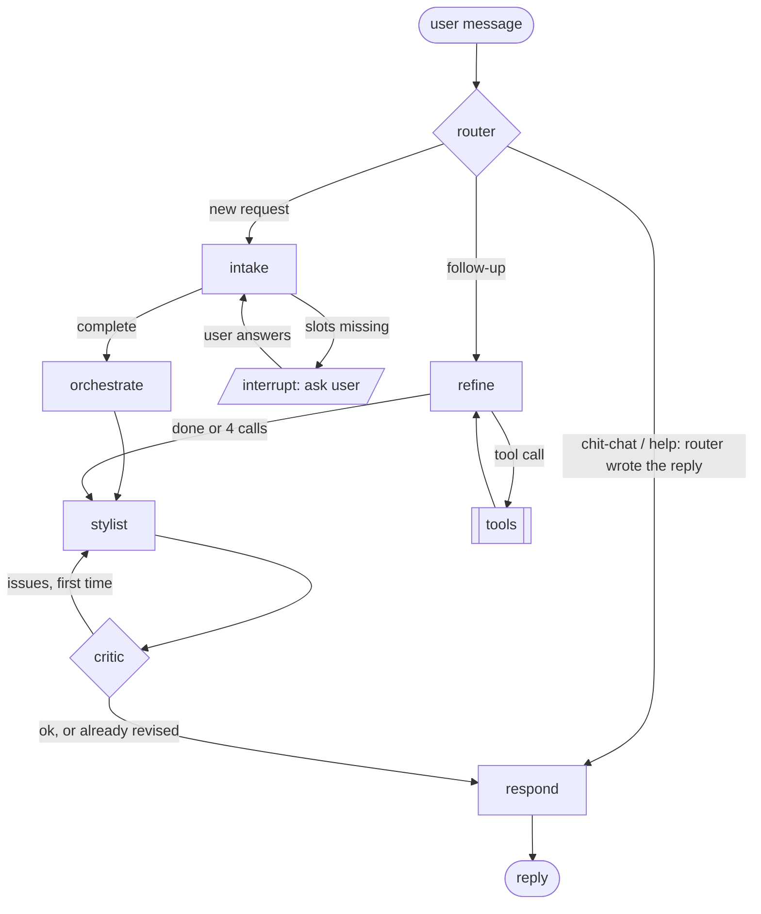

# Agentic architecture (Phase 4)

How the outfit chatbot turns a message like *"what should I wear to a party in Pune
tonight?"* into a recommendation from the user's own wardrobe: which agents exist,
why the system is shaped this way, and how data moves between the parts.

Status: **design**, agreed before implementation. Phase 3 tools it builds on are done
and tested (`src/outfit/tools/`).

---

## 1. The short version

The system is a **LangGraph workflow with agents only at the decision points**:

- **Plain Python** runs everything whose order is known: fetch weather, then assemble
  and rank outfits. These are the Phase 3 tools: deterministic and unit-tested.
- **LLM agents** (DeepSeek `deepseek-flash`) do only what needs language:
  understanding the request, asking for what is missing, explaining the choice,
  checking that explanation, and handling open-ended follow-ups.

| Node | Kind | Job |
|---|---|---|
| `router` | LLM, JSON | Is this a new request, a follow-up on the last suggestion, or chit-chat? |
| `intake` | LLM, JSON + **human-in-the-loop** | Fill the request slots; ask the user for anything missing |
| `orchestrate` | **plain Python** | `weather_for_outing` → `suggest_outfits` → `OutfitPlan` |
| `refine` | LLM, **ReAct** (tool calling) | Open-ended follow-ups: search, re-plan, swap items |
| `stylist` | LLM | Write the reply from the plan, and nothing but the plan |
| `critic` | Python checks + LLM, **reflection** | Catch invented items, missing warnings; one revision max |
| `respond` | plain Python | Final reply; template fallback if the critic still objects |

---

## 2. Why this architecture

### Not pure ReAct

In ReAct (reason → act → observe, repeated) the LLM chooses the next tool at every
step. That is right when the path is unknown. Ours mostly is not: every new request
needs the same steps in the same order, *understand → weather → outfits → explain*.
Making the LLM rediscover that order on every request would:

- add latency and API calls for no benefit;
- risk skipping the weather or ranking, or describing a garment the user does not own;
- make runs non-repeatable, and so hard to test.

The tool layer was built deterministic on purpose; a pure ReAct agent would throw
that away.

### ReAct where the path really is open

Follow-ups are different. *"Something less formal"*, *"what goes with my white
tee?"*, *"show me similar tops"* may need a search, a new plan, or both, in an order
nobody can fix in advance. Only the `refine` node is a ReAct loop, with a hard cap
on tool calls.

### Not a simple reflex agent

A reflex agent maps the current input straight to an action. A conversation needs
memory: *"Pune, tonight"* in one turn and *"by scooter"* in the next must add up to
one request. State lives in the graph and is saved per conversation thread.

### Reflection, bounded

The `critic` is a light form of Reflexion (critique, then revise). Cheap code checks
run first (did the reply mention only items in the plan? did it pass on the weather
warnings?), then an LLM rubric. It may send the draft back **once**; an unbounded
self-critique loop costs time and money and rarely improves the second revision.

### Why LangGraph

- **The design is a graph**, and LangGraph makes it explicit: nodes, edges and
  conditional routes are code, and `graph.get_graph().draw_mermaid()` renders it.
- **Typed shared state** with reducers: every node reads and returns part of one
  `ChatState`, so data flow is visible.
- **Human in the loop**: `interrupt()` pauses the graph to ask the user a question;
  `Command(resume=answer)` continues where it stopped.
- **Memory across turns**: a checkpointer (`InMemorySaver`, keyed by `thread_id`)
  stores the state between messages.
- **Bounded loops**: the ReAct and critic loops are conditional edges with counters
  in state, not hidden framework behavior.

LLM calls do **not** go through LangChain model wrappers. Nodes call DeepSeek with
the same OpenAI-compatible client the tagger uses (`outfit.ingestion.tagger.make_client`),
so there is one client, one retry policy and one test fake (`tests.fakes.FakeClient`).
LangGraph only orchestrates. (`langgraph` brings `langchain-core` as a dependency;
neither pulls in torch.)

---

## 3. The graph



Each user message is one run of the graph on the conversation's `thread_id`. When
`intake` needs to ask something, the run **pauses** at `interrupt()`; the user's
answer resumes the same run instead of starting a new one.

With a user profile (`Context.profile`, read every turn), intake also knows the
user's saved places and home city. Naming a saved place ("office tomorrow") sets its
occasion and dress code straight away; its usual trip is offered as one question
("Same as usual for Office: ...?", the pseudo-slot `saved_trip`) and filled in only
after a yes, while "yes, but ..." keeps the changes. A request without a city uses
the home city. Each of these is an assumption the stylist passes on. Orchestrate adds
the profile's taste (`Profile.taste_fields()`: liked and avoided colors, preferred fits,
colours from the optional colouring analysis) to the `OutfitRequest`, so it changes
ranking only, never which outfits are allowed.

---

## 4. Shared state: how input is passed

Every node receives the whole state and returns only the fields it changes;
LangGraph merges them. Lists that grow (messages) use an append reducer.

```python
class Slots(BaseModel):  # what the user wants, filled over turns
    occasion: Occasion | None = None
    formality: tuple[int, int] | None = None
    city: str | None = None
    skip_weather: bool = False  # user doesn't know / care: plan without weather
    start: str | None = None  # in parse_start format: "now", "19:00", "tomorrow 9:00"
    hours_away: float | None = None
    hours_outdoors: float | None = None
    transport: Transport | None = None
    must_include: list[str] = []  # item descriptions or ids ("my white tee")
    exclude: list[str] = []


class ChatState(TypedDict):
    messages: Annotated[list[dict], operator.add]  # chat history (role/content)
    intent: Literal["new", "follow_up", "chat"] | None
    slots: Slots
    missing: list[str]  # slot names intake still needs
    asks: int  # questions asked for this request (max 3)
    assumptions: list[str]  # defaults used instead of asking, for the stylist to mention
    weather: WeatherSummary | None
    advice: WeatherAdvice | None
    plan: OutfitPlan | None  # the facts the stylist may talk about
    previous_slots: Slots | None  # the request before a "new" one
    found: list[ClothingItem]  # items refine chose to show this turn
    react: list[dict]  # refine's tool-calling transcript this turn
    tool_calls: int  # ReAct tool calls this turn (max 4)
    draft: str | None
    critique: list[str]  # issues found by the critic
    revisions: int  # critic → stylist round trips (max 1)
    reply: str | None
```

### Turn by turn

| Step | Reads | Writes |
|---|---|---|
| message arrives | — | `messages += [{"role": "user", ...}]` |
| `router` | last message, previous request + `plan` | `intent`; new: clears `slots`/`plan`, sets `previous_slots`; chat: `draft` |
| `intake` | last message, last question, `slots`, `asks`, the profile's places and home city | `slots` (merged), `missing`, `assumptions` |
| `ask` | `missing`, `slots` | pauses with `interrupt()`; writes the question and the answer to `messages`, `asks += 1` |
| `orchestrate` | `slots` | `weather`, `advice`, `plan` |
| `refine` / `tools` | `messages`, `slots`, `plan`, `react` | `react`, `tool_calls`; tools: `slots`, `plan`, `weather`, `found` |
| `stylist` | `plan`, `advice`, `found`, last message, `critique` | `draft` |
| `critic` | `draft`, `plan`, `advice` | `critique`, `revisions` |
| `respond` | `draft` or `plan` | `reply`, `messages += [assistant]` |

### What crosses each boundary

- **User → graph**: free text only.
- **LLM → graph**: never free text where structure is needed. `router`, `intake` and
  `critic` reply in DeepSeek JSON mode, validated by Pydantic, retried once with the
  error (the same contract as the tagger). `refine` uses tool calling; DeepSeek
  documents that tool arguments may be invalid JSON, so every call is validated
  before it runs.
- **Graph → LLM**: tags and plan facts as JSON, never photos. The only images ever
  sent off the machine are the ingestion cutouts.
- **Graph → Open-Meteo**: the city name, then its coordinates. Nothing else.

---

## 5. Each agent

### `router`: what kind of message is this?

- **Input**: the last user message and, if a plan exists, the previous request, its
  top outfit and the last reply.
- **Output**: `{"intent": "new" | "follow_up" | "chat", "reply": ...}`; `reply` only
  (and always) for `chat`.
- **Why an LLM**: *"and if it rains?"* and *"what about a wedding instead?"* are
  follow-up vs new request by meaning, not by keyword. One small JSON call per new
  message; a resumed answer to `ask` continues in `ask` and skips it.
- Rules in code: with no previous plan, `follow_up` becomes `new`. `new` clears
  `slots`, `plan` and weather (two outings never mix) and keeps the old slots as
  `previous_slots`, which intake sees only to resolve *"same city as before"*.
- `chat` (thanks, greetings, "what can you do?") is answered by the router in the
  same call and goes straight to `respond`: it never names or recommends garments,
  so there is nothing for the stylist or critic to do. A failed call → `new`.

### `intake`: fill the slots, ask for what is missing

- **Input**: the last user message and the current `slots`.
- **Output**: a *patch* of slots (only what the message states), merged in code.
  The LLM never resets a slot it was not told about. Times are normalized to the
  formats `parse_start` accepts (*"tonight"* → `"19:00"`, *"tomorrow morning"* →
  `"tomorrow 9:00"`); code validates them with `parse_start` and asks again if
  they don't parse.
- **Required before planning**: `occasion`; for weather, `city`, `hours_away`,
  `hours_outdoors` and `transport`. Time outdoors is always asked, never assumed.
  The only default is `start="now"`, applied in code and recorded in
  `assumptions` so the stylist can say *"assuming you're leaving now"*.
- **Asking** is a separate `ask` node. On resume LangGraph re-runs the interrupted
  node from the start, so keeping `interrupt()` out of `intake` means a resume never
  repeats the DeepSeek call. `ask` builds one combined question from a template
  (predictable and testable, not LLM-written), e.g. *"Got it. Which city will you be
  in? About how many hours will you be out? …"*, pauses, and the answer comes back
  as the next user message for `intake`.
- **Stops asking** after 3 questions: a still-missing occasion becomes `casual` and
  missing trip details turn weather off, both recorded in `assumptions`.
- The user may skip weather (*"no idea, just suggest"*): `skip_weather=True`, and
  only the occasion is required. Naming a city later turns weather back on.

### `orchestrate`: the fixed pipeline, no LLM

```python
outing = Outing(start=parse_start(slots.start, local_now(place)), ...)
place, weather, advice = weather_for_outing(slots.city, outing)
request = OutfitRequest(occasion=..., advice=advice, ...)
plan = finish_plan(suggest_outfits(items, request), items, request)  # + accessories
```

- Accessories (belt, tie, bag, sunglasses ...) are added after the outfits are chosen,
  at most one per kind, without changing their rank (`tools/accessories.py`,
  [`phases/accessories.md`](phases/accessories.md)).

- Item references like *"my white tee"* are resolved to ids before planning, **tags
  first** (`tools/match.py`): the reference's head noun (*"tee"*, *"skirt"*) must be one
  of the item's garment words, then the item whose tags contain the most of the
  reference's words wins. CLIP (`WardrobeSearch.by_text`, loaded only when needed)
  breaks ties (*"black top"*: two black tops) and handles references no tag matches
  (*"something sparkly"*), where it needs score ≥ 0.24: on the real wardrobe, items that
  exist scored 0.258–0.340 and items that don't (*"red saree"*, *"sneakers"*) at most
  0.222. Tags come first because the Phase 5 eval showed CLIP alone mis-ranks real
  items: *"lavender skirt"* scored the beige trousers higher (0.243 vs 0.226), and
  *"black sequin top"* found the right item at only 0.231. Every match goes into
  `assumptions` (*"took 'my blue jeans' to mean your medium blue jeans"*), so a wrong
  match is visible, not silent.
- Dependencies (store, weather fetcher, resolver) are injected as a `Context`, so
  tests use an in-memory wardrobe and fake weather.
- A `WeatherError` does not fail the turn: planning continues without advice and
  the assumption *"couldn't check the weather (...)"* (`WEATHER_FAILED`) is added, so
  the stylist says so. It is not a gap: the chat page lists gaps as "missing from
  your wardrobe", and the wardrobe is not missing a forecast.
- Fully deterministic; tested without any LLM.

### `refine`: the ReAct agent

- **Input**: the conversation, current `slots` and `plan`.
- **Tools** (DeepSeek function calling, `tool_choice="auto"`):

  | Tool | Wraps |
  |---|---|
  | `search_wardrobe(query, category?, occasion?)` | tag matches first, then `WardrobeSearch.by_text`; `weak` = below `MIN_MATCH_SCORE` and no tag match |
  | `similar_items(item_id, category?)` | `WardrobeSearch.similar_to` |
  | `update_request(changes)` | `IntakePatch` → `merge_slots`, then re-run `orchestrate` |
  | `show_items(item_ids)` | put items in `found`, for "show me my tops" |

  `get_weather` was dropped from the first design: a weather question is about an
  outing, and `update_request` re-plans with that outing's forecast, so weather
  facts reach the stylist through state instead of through the model's words.
  Items are shown to the model with 8-character id prefixes.
- **Loop**: two graph nodes, `refine` (LLM step) and `tools` (plain Python), with the
  transcript in `react` and a counter in `tool_calls`. Arguments are validated with
  Pydantic; invalid JSON, bad values and unknown tools go back as a tool error. The
  loop ends when the model answers without a tool call or after **4 calls** (the
  model is not asked again; extra calls in the last step get a "budget used up"
  result).
- **Output**: state only (`slots`, `plan`, `weather`, `found`, and an assumption
  when a searched item is not in the wardrobe). The model's closing sentence is
  logged and dropped; the reply is written by `stylist` from the facts and passes the
  critic like every other reply.

### `stylist`: explain, do not invent

- **Input**: `plan` (outfits with their `reasons`, `warnings` and `gaps`), `advice`
  notes, the request, and any `critique` from a first attempt.
- **Output**: a short, friendly reply: the top outfit, one or two alternatives, why
  they work (from `reasons`), what to watch out for (from weather notes and
  `warnings`), and what the wardrobe lacks (from `gaps`).
- **Rule**: it may only name items that are in `plan`. The system prompt says so,
  and the critic checks it.
- Replies as JSON `{"message": ...}` (same `chat_json` contract). If the call fails,
  it leaves no draft and `respond` uses the template.

### `critic`: reflection with a hard limit

1. **Code checks** (free, deterministic, `critic.code_checks`):
   - every "your <garment>" in the draft matches a plan piece (noun and any color
     word) or something else in the facts (assumptions, warnings, gaps). The stylist
     uses "your" only for plan pieces and "a" for suggestions, so "a light jacket
     would help" is never flagged;
   - every `gap` with a known topic (footwear, outerwear) is passed on, and so is a
     failed weather check (`ASSUMPTION_TOPICS`);
   - rain, UV and wind/flowy notes are mentioned when present.
2. **LLM rubric** (JSON, `prompts/critic.md`), first pass only and only if the code
   checks pass: answers the request, leads with option 1, does not contradict the
   facts, passes on `warnings` and `assumptions`, right tone and length. Returns
   `{"ok": bool, "issues": [...]}`; a failed call counts as ok.
3. **Routing**: any issue on the first pass → back to `stylist` (`revisions = 1`),
   which gets `previous_draft` and `fix_these_issues`. The revision gets only the
   code checks, and is never sent back: a still-invented piece drops the draft (→
   template), and notes or gaps it still leaves out are appended verbatim.

### `respond`

Sends the draft. If there is no draft (the stylist failed) or the critic still found
a **factual** issue after the revision (an invented item), it sends a plain
template reply built directly from the `plan` instead: less charming, never wrong.
It also resets the per-request counters (`asks`, `assumptions`, `critique`,
`revisions`), keeping `slots` and `plan` for follow-ups.

---

## 6. Example run

> **User:** what should I wear to a party tonight?

1. `router` → `new` (no previous plan).
2. `intake` → `occasion=party`, `start="19:00"` (normalized from *"tonight"*); missing:
   `city`, `hours_away`, `hours_outdoors`, `transport`. `ask` → `interrupt()`:
   *"Got it. Which city will you be in? About how many hours will you be out? How
   much of that time will you spend outdoors? How will you get there: …?"*

> **User:** Pune, 4 hours, maybe half an hour outside, by cab

3. The run resumes in `ask`, which passes the answer on. `intake` → `city=Pune`,
   `hours_away=4`, `hours_outdoors=0.5`, `transport=car`. Complete.
4. `orchestrate` → 26–30 °C, warmth 1–2, no outerwear → 3 outfits, top: black shirt
   + lavender skirt + champagne heels (0.93).
5. `stylist` → draft. `critic`: code checks pass; rubric ok → `respond`.

> **User:** something with my blue jeans instead

6. `router` → `follow_up`. `refine` calls `search_wardrobe("blue jeans")` → item id →
   `update_request({"must_include": [id]})` → new plan, with warnings (*jeans are
   formality 2, the party wants 3–5*). Then `stylist` → `critic` → `respond`, which
   passes the warning on.

---

## 7. Limits and failure handling

| What | Limit or behavior |
|---|---|
| JSON replies (router, intake, critic) | Pydantic-validated; 1 retry with the error, then a safe default (`router` → `new`; `intake` → ask again; `critic` → ok) |
| Reasoning eats the budget | DeepSeek counts thinking against `max_tokens`; the critic rubric gets 4096 (`critic_max_tokens`), the rest 2048, sized from eval token usage |
| ReAct tool calls | max 4 per turn; invalid arguments are returned to the model as a tool error |
| Critic revisions | max 1; then a template reply if facts are still wrong |
| Weather down | plan without weather, assumption *"couldn't check the weather (...)"* |
| Empty wardrobe or nothing fits | the stylist explains the `gaps`; no invented outfits |
| `content_filter` | not retried; polite refusal reply |

## 8. Testing

- **Deterministic nodes** (`orchestrate`, slot merging, defaults, critic code checks,
  routing functions) are plain unit tests.
- **LLM nodes** use `tests.fakes.FakeClient` with queued replies, including tool-call
  replies for `refine`, so the whole graph runs end to end in tests with no network.
- **Graph tests** drive multi-turn conversations through `interrupt()` /
  `Command(resume=...)` on an `InMemorySaver`, asserting on state after each turn.

## 9. Code layout

```
src/outfit/agents/
  state.py       # Slots, ChatState
  llm.py         # JSON-mode call + Pydantic + retry, shared by router/intake/stylist/critic
  router.py      # new / follow_up / chat
  intake.py      # intake_node (extract + merge) and ask_node (interrupt)
  orchestrate.py # refs -> weather -> suggest_outfits; Context
  refine.py      # ReAct loop + tool schemas
  stylist.py
  critic.py
  respond.py     # final reply + template fallback
  graph.py       # build_graph(): nodes, edges, checkpointer
  recording.py   # run_turn, RecordingClient (Phase 5 evals, the API)
src/outfit/prompts/
  router.md  intake.md  refine.md  stylist.md  critic.md
scripts/chat.py  # terminal chat on one thread, for manual testing
```

The same graph serves the terminal chat, the eval runner (Phase 5) and the API's
`POST /chat` (Phase 6), which the Streamlit chat page calls (Phase 7).

## 10. Build order

1. ✅ `state.py`, `llm.py`, `intake.py` + the `interrupt` loop: the bot can gather a
   request over several turns.
2. ✅ `orchestrate.py` + `stylist.py` + `respond`: first full recommendation
   (`scripts/chat.py` was pulled forward from step 5 to try it live).
3. ✅ `critic.py`: reflection loop.
4. ✅ `router.py` + `refine.py`: follow-ups via ReAct.
5. ✅ Became Phase 5 ([`phases/phase-5-evaluation.md`](phases/phase-5-evaluation.md)):
   recorded conversations, a 21-scenario eval against the real model, and the fixes it
   led to (tag-first item matching, a weather assumption when weather is skipped, the
   critic's own token budget, clearer intake and stylist/critic wording).
