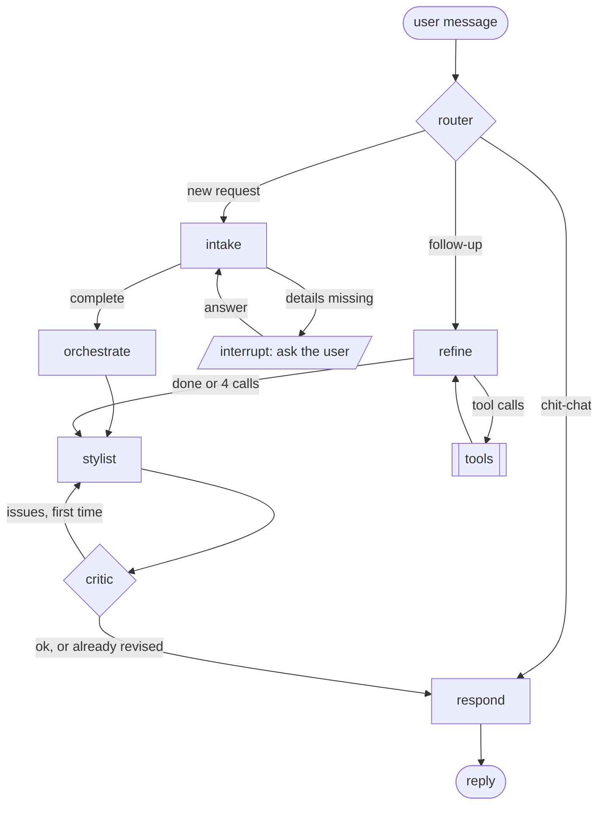

# Phase 4 — Agents

A multi-agent chatbot on LangGraph that turns *"what should I wear to a party in Pune
tonight?"* into a recommendation from your own wardrobe. It asks for what it needs,
handles follow-ups, and checks its own reply before sending it.

The full design (state fields, data flow per node, failure table) is in
[`../agentic-architecture.md`](../agentic-architecture.md). This page is the overview.

## The idea: agents only at the decision points

A new request always needs the same steps: *understand → weather → outfits →
explain*. Making an LLM rediscover that order every time (pure ReAct) would add
latency and cost, risk skipping a step, and make runs unrepeatable. So:

- **plain Python** runs the fixed steps (the Phase 3 tools);
- **LLM agents** (DeepSeek `deepseek-flash`) do only what needs language:
  classify the message, extract the request, explain the plan, check the
  explanation, and handle open-ended follow-ups;
- **ReAct** is used in exactly one place, follow-ups, where the path really is open.

## The graph



| Node | File | Kind | Job |
|---|---|---|---|
| `router` | `agents/router.py` | LLM, JSON | New request, follow-up, or chat? Writes chat replies itself |
| `intake` | `agents/intake.py` | LLM, JSON | Extract a patch of the request; code merges and validates it |
| `ask` | `agents/intake.py` | **human-in-the-loop** | `interrupt()` with one combined question; max 3 questions |
| `orchestrate` | `agents/orchestrate.py` | plain Python | Resolve "my blue jeans" → weather → `suggest_outfits` |
| `refine` + `tools` | `agents/refine.py` | LLM, **ReAct** | Follow-ups via function calling; max 4 tool calls |
| `stylist` | `agents/stylist.py` | LLM, JSON | Write the reply from the plan's facts only |
| `critic` | `agents/critic.py` | code + LLM, **reflection** | Catch invented garments and dropped notes; max 1 revision |
| `respond` | `agents/respond.py` | plain Python | Send the draft, or a template from the plan; reset per-turn fields |

Supporting files: `state.py` (`Slots`, `ChatState`), `llm.py` (`chat_json`),
`graph.py` (`build_graph`, checkpointer, serde allowlist), prompts in
`src/outfit/prompts/*.md`.

## How each pattern is used

### Human-in-the-loop: intake + ask

- The intake LLM returns only what the latest message says (`IntakePatch`). Code
  merges it field by field (`merge_slots`), dropping values that don't validate.
- Required: occasion; for weather, city, hours away, hours outdoors and transport.
  Time outdoors is always asked, never assumed. The only default is leaving now,
  and it is recorded in `assumptions` so the reply can say so.
- Asking lives in its own `ask` node. On resume, LangGraph re-runs the interrupted
  node from the start; keeping `interrupt()` out of the LLM node means a resume never
  repeats a model call (tests count the requests to prove it).
- After 3 questions, intake gives up safely: occasion → casual, weather off, both
  recorded as assumptions.
- After a new request, the old one is kept as `previous_slots` only so intake can
  resolve *"same city as before"*.
- Added later, with the user profile: a named saved place ("office tomorrow") brings
  its occasion and dress code, and its usual trip is confirmed in one question
  ("Same as usual for Office: ...?") before it is used; a missing city defaults to the
  home city. Each is an assumption (`test_intake_profile.py`).

### Plain-Python orchestration

`orchestrate` resolves item references ("my blue jeans") by tags first
(`tools/match.py`), with CLIP for ties and for references no tag matches (score ≥ 0.24,
measured on the real wardrobe: real items scored 0.258–0.340, missing ones at most
0.222), gets the weather, and calls `suggest_outfits`, then (added later)
`accessories.finish_plan`, which adds a belt, tie, bag ... to each outfit without
changing its rank ([`accessories.md`](accessories.md)). Tags come first since the
Phase 5 eval, which caught CLIP alone picking the wrong item. Every match and miss goes into `assumptions`,
so a wrong guess is visible. If the weather fails, it plans without weather and records
that as an assumption the reply must mention, instead of failing the turn. With a
profile, the request also carries the user's taste (liked and avoided colors,
preferred fits) for outfit ranking.

### ReAct: refine

Follow-ups like *"something with my blue jeans instead"* or *"show me my other tops"*
use DeepSeek function calling with four tools:

| Tool | Does |
|---|---|
| `search_wardrobe(query, category?, occasion?)` | Tag matches first, then CLIP text search; weak CLIP matches flagged |
| `similar_items(item_id, category?)` | Items that look like one |
| `update_request(changes)` | Change the request, then re-run orchestrate |
| `show_items(item_ids)` | Put items in front of the user |

Arguments are validated with Pydantic; bad JSON, bad values and unknown tools go back
to the model as tool errors. The loop stops when the model answers without a tool call
or after 4 calls. The model's own closing text is logged and dropped: the reply is
always written by the stylist from state, and always goes through the critic.

### Reflection: stylist + critic

- The stylist sees only `facts(state)`: the plan, weather notes, warnings, gaps,
  assumptions, items to show and the user's message. It never sees the wardrobe or
  photos, so it cannot recommend something that isn't in the plan.
- It says "your …" only for plan pieces and "a …" for suggestions. The critic's code
  checks rely on that: every "your <garment>" must match a plan piece or a known
  fact; gaps and rain, UV and wind notes must be passed on. (Added later: accessory
  words count as garments, and the accessory gaps such as "no sunglasses for the
  strong sun" must be passed on too.)
- If the code checks pass, an LLM rubric checks tone, length and faithfulness (first
  pass only; a failed rubric call counts as ok).
- Any issue on the first pass sends the draft back once with the issues. The revision
  is never sent back again; the critic makes it safe instead: a still-invented
  garment drops the draft (respond uses the template), and missing notes are appended
  word for word.

## Design rules

- **Every loop is bounded and visible**: question, tool-call and revision limits are
  counters in state and conditional edges, not hidden framework behavior.
- **Code owns defaults and validation**; the LLM proposes, code decides.
- **No LangChain model wrappers.** Every LLM call uses the same DeepSeek client as the
  tagger, through `chat_json` (JSON mode, Pydantic, one retry with the error). LangGraph
  only orchestrates.
- **Memory per conversation**: `InMemorySaver` keyed by `thread_id`. Every type stored
  in state is registered in `graph.STATE_TYPES` for the checkpoint serializer.

## Build order

1. ✅ State, `chat_json`, intake + the interrupt loop.
2. ✅ Orchestrate, stylist, respond: the first full recommendation (and `scripts/chat.py`).
3. ✅ Critic: the reflection loop.
4. ✅ Router + refine: follow-ups via ReAct.
5. → Became [Phase 5](phase-5-evaluation.md): recorded conversations, a scenario eval,
   and the fixes it led to.

## Commands

```bash
python scripts/chat.py            # terminal chat on one thread
python scripts/chat.py --verbose  # also logs what each agent does
python scripts/chat.py --record   # save every turn as JSON (Phase 5)
```

## Testing

- Deterministic parts (slot merging, defaults, orchestrate, critic code checks,
  routing functions) are plain unit tests.
- LLM nodes use `tests.fakes.FakeClient` with queued replies: `router_reply`,
  `stylist_reply`, `critic_reply`, `tool_call_reply`. `FakeSearch` replaces CLIP with
  word overlap.
- Graph tests drive whole conversations through `graph.invoke(...)` and
  `Command(resume=answer)` on a `thread_id`, asserting on interrupts, state and the
  number of model calls.
- Files: `test_agent_llm.py`, `test_intake.py`, `test_agent_flow.py`,
  `test_critic.py`, `test_router_refine.py`.
